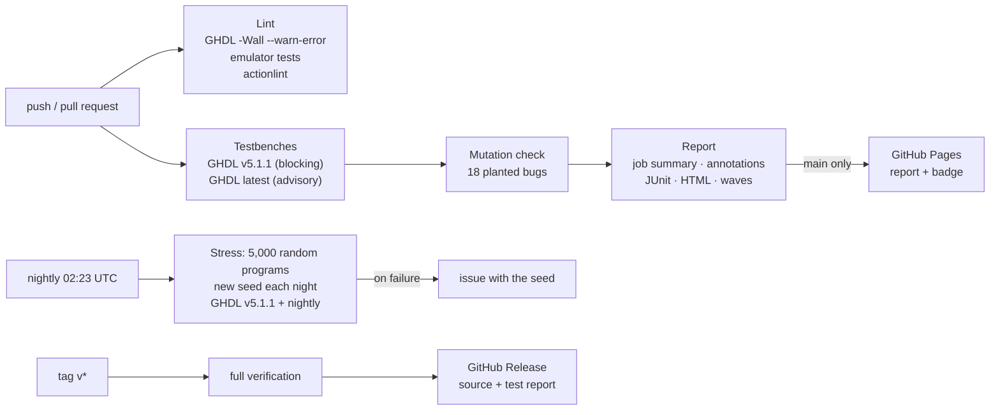

<p align="center">
  <picture>
    <source media="(prefers-color-scheme: dark)" srcset="docs/assets/logo-dark.svg">
    
  </picture>
</p>

<p align="center">
  <a href="https://github.com/OWNER/REPO/actions/workflows/ci.yml"></a>
  <a href="https://OWNER.github.io/REPO/"></a>
  <a href="https://github.com/OWNER/REPO/actions/workflows/nightly.yml"></a>
</p>

Sprout-8 is a small 8-bit CPU designed for teaching: four registers, a 256-byte address
space, sixteen opcodes and one fixed two-byte instruction format. This repository holds the
ISA manual, a reference VHDL implementation, self-checking testbenches for every part, a
Python emulator and the CI that ties them together.

- **Spec:** [The Sprout-8 Instruction Set Manual](docs/spec/sprout8-isa-manual.md)
- **Latest test report:** https://OWNER.github.io/REPO/

## Quick start

Install [GHDL](https://github.com/ghdl/ghdl) (5.1.1 or newer) and Python 3.10+, then:

```sh
make ci                               # lint + emulator tests + all testbenches + report
open build/report/index.html          # the HTML test report
python3 sw/emulator/sprout8.py sw/programs/b2_print_string.hex
```

## Repository layout

```
docs/spec/            ISA manual (the source of truth)
docs/assets/          logo
hw/rtl/               reference implementation, VHDL-2008
hw/tb/                testbenches, golden model, test data
hw/manifest.json      source order, testbench list, per-bench generics and profiles
sw/emulator/          Python instruction-set emulator + unit tests
sw/programs/          example programs (.hex), loadable by the emulator and by mem_io INIT_FILE
tools/run_tests.py    compile + run testbenches in parallel -> results.json, junit.xml, logs, waves
tools/report.py       results -> index.html, summary.md (CI job summary), badge.json
tools/mutation_check.py  plants bugs in the RTL and checks the testbenches catch them
.github/workflows/    CI, nightly stress, releases
```

## CI/CD



| Workflow | Trigger | What it does |
|---|---|---|
| `ci.yml` | push to `main`, pull requests | Strict VHDL lint, emulator tests, workflow lint; all testbenches on the pinned and latest GHDL; mutation check; report as job summary, failure annotations, artifact (HTML, JUnit, logs, waveforms of failures); on `main`, deploys the report and badge to GitHub Pages |
| `nightly.yml` | daily, manual | `tb_cpu` with 5,000 random programs and a new seed each night, on GHDL v5.1.1 and GHDL nightly; opens or updates an issue with the seed when it fails |
| `release.yml` | tag `v*` | Full verification, then a GitHub Release with the source bundle, the test report and notes from `CHANGELOG.md` |
| `dependabot.yml` | weekly | Keeps the action versions current |

One-time repository settings (Pages source, branch protection) are listed in
[CONTRIBUTING.md](CONTRIBUTING.md#repository-settings-one-time-by-a-maintainer).

## What is tested

| Testbench | Checks | Covers |
|---|---:|---|
| `tb_alu` | 524,309 | Every op × every A × every B against an integer model, plus spec edge cases |
| `tb_regfile` | 4,055 | Reset, all port combinations, write enable, read-during-write, 2,000 random cycles |
| `tb_flags` | 19 | Reset, all patterns load and hold |
| `tb_pc` | 517 | Reset, 256-step wrap, load, load beats increment |
| `tb_sp` | 262 | Reset to 0xF0, wrap both ways |
| `tb_reg8` | 514 | MAR: reset generic, every value, hold |
| `tb_ir` | 1,795 | Half loads, field decode for all 256 byte-0 values |
| `tb_mem_io` | 791 | INIT_FILE, all RAM, RAM survives reset, I/O isolation, LEDS, SWITCHES, TTY_OUT, TTY_STATUS, TTY_IN consume-on-read |
| `tb_control` | 11,911 | All 256 byte-0 values × all flag states: control word at every step vs. the spec 7.2 table, cycle counts, halt/illegal |
| `tb_cpu` | 28,962 | Reset state, Appendix B programs with exact cycle counts, conformance tests C2–C16, halt quiescence, 300 random programs in lockstep with the golden model |

The suite is itself tested: `tools/mutation_check.py` plants 18 realistic bugs and expects a
testbench to fail for each one.

## Using the testbenches with your own CPU

The testbenches test the entity interfaces of the reference design. Keep the entity names and
ports below (or adapt the port maps), point `hw/manifest.json` at your files, and run
`make test`. When `tb_cpu` diverges from the golden model it names the instruction and prints
both states.

| Entity | Ports |
|---|---|
| `alu` | `a, b, op → y, z, c, n` (combinational) |
| `regfile` | `clk, rst, we, waddr, wdata, raddr_a, raddr_b → rdata_a, rdata_b, contents` |
| `flags` | `clk, rst, load, z_in, c_in, n_in → z, c, n` |
| `pc` | `clk, rst, inc, load, d → q` |
| `sp` | `clk, rst, inc, dec → q` |
| `reg8` | generic `RESET_VALUE`; `clk, rst, load, d → q` |
| `ir` | `clk, rst, load0, load1, d → ir0, ir1, opcode, rd, rs` |
| `mem_io` | generic `INIT_FILE`; `clk, rst, addr, wdata, we, re → rdata`; `leds, switches, tty_*` |
| `control` | `clk, rst, ir0, z, c → ctrl (ctrl_t), step, halted, illegal` |
| `cpu` | `clk, rst`, memory bus, `halted, illegal`, debug `dbg_*` incl. `dbg_retire` |

Types are in `hw/rtl/sprout8_pkg.vhd`. Choices the spec leaves open (ALU codes, synchronous
resets, INC/DEC via a forced B = 1, strobe timing) are documented at the top of each RTL file.

## Contributing

See [CONTRIBUTING.md](CONTRIBUTING.md). Bugs and ISA proposals use the issue templates.

## License

[Choose a license before publishing. Common choices for open hardware: CERN-OHL-P-2.0 or
Solderpad 2.1 for the RTL, CC BY 4.0 for the manual.]
