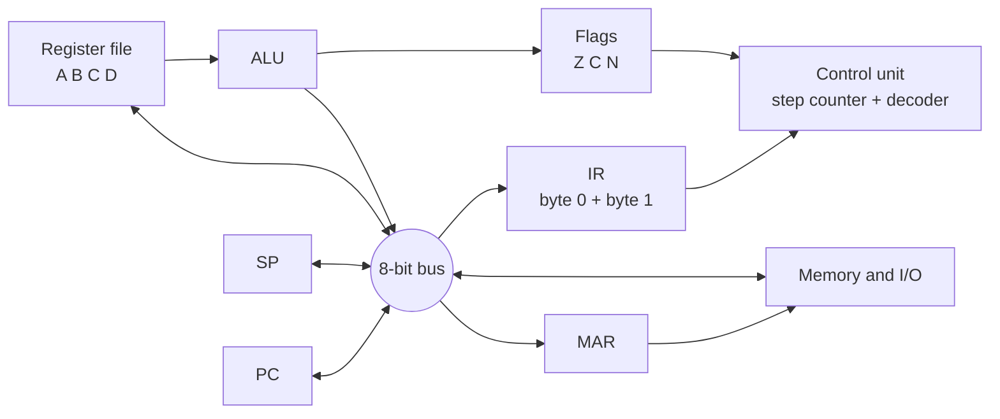
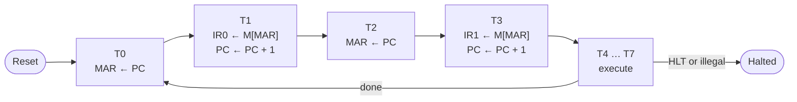

# The Sprout-8 Instruction Set Manual

**Volume I: Base Architecture** · Document version 1.0-draft · Oct 21, 2026

## Preface

This document specifies version 1.0 of the Sprout-8 base instruction set architecture (ISA). It defines everything software can observe: the architectural state, the memory and I/O model, instruction encodings and the precise effect of each instruction. Chapter 7 also describes a reference multi-cycle implementation. That chapter is informative: an implementation may use any internal structure as long as its observable behavior matches the normative chapters.

### Document status

| Item | Value |
| --- | --- |
| ISA version | 1.0 |
| Document version | 1.0-draft |
| Status | Draft. Open for review; encodings may still change before 1.0 is frozen |
| License | \[LICENSE, e.g. CC BY 4.0\] |
| Maintainer | \[PROJECT MAINTAINER\] |

Once version 1.0 is frozen, the encodings and behavior in Chapters 3 to 6 will not change. Later versions may only use encodings this document marks as reserved.

### Version history

| Version | Date | Changes |
| --- | --- | --- |
| 1.0-draft | 2026-10-21 | First complete draft |

## 1. Introduction

Sprout-8 is a small 8-bit load/store architecture designed for teaching. A student should be able to read this manual, hand-assemble a program, trace it on paper and then build a working processor in a logic simulator or hardware description language.

### 1.1 Design goals

1. **Traceable by hand.** The whole architectural state is four data registers, two 8-bit pointers and three flags.
2. **One instruction format.** Every instruction is exactly two bytes with fixed field positions, so the decoder is a single table lookup.
3. **Complete enough to be interesting.** Arithmetic, logic, comparison, conditional branches, pointers, a stack and subroutine calls are all present.
4. **Visible results.** Input and output are memory-mapped at fixed addresses, so the simplest program can light LEDs or print text.
5. **Fully specified.** Every encoding, including the reserved ones, has a defined behavior, so any two conforming implementations produce identical results.

### 1.2 Non-goals

Version 1.0 deliberately leaves out interrupts, privilege levels, memory protection, caches, multiplication and division, signed-overflow detection, and any address space larger than 256 bytes. Section B.4 lists these as candidate extensions.

### 1.3 Architecture summary

| Property | Value |
| --- | --- |
| Data word | 8 bits |
| Address space | 256 bytes, byte-addressed |
| General-purpose registers | 4 (A, B, C, D) |
| Other architectural state | PC, SP, flags Z, C, N, and a halted bit |
| Instruction length | 2 bytes, fixed |
| Major opcodes | 16 |
| Memory access | Load/store only. ALU operations act on registers |
| I/O | Memory-mapped, 0xF0 to 0xFF |
| Exceptions | None. Illegal instructions halt the processor (Section 5.4) |

## 2. Terminology and notation

### 2.1 Requirement levels

**MUST** and **MUST NOT** state absolute requirements for a conforming implementation. **SHOULD** marks a strong recommendation that may be ignored for good reason. **MAY** marks something optional.

### 2.2 Defined terms

| Term | Meaning |
| --- | --- |
| Architectural state | The state software can observe: registers, PC, SP, flags, the halted bit, and memory |
| Implementation | Any hardware, simulator or emulator that executes Sprout-8 code |
| Reserved | An encoding or address set aside for future versions. Its v1.0 behavior is defined in this document. Software MUST NOT use it |
| SBZ (should be zero) | A field software MUST set to zero. Implementations MUST ignore its value |
| Illegal instruction | An instruction whose encoding is reserved (Section 5.4) |
| Halted | The processor state in which no further instructions execute until reset |

### 2.3 Notation

| Notation | Meaning |
| --- | --- |
| 0x3C | Hexadecimal value |
| 0b0011 | Binary value |
| x\[7:4\] | Bits 7 down to 4 of x. Bit 0 is the least significant |
| R\[rd\] | The register selected by field rd |
| M\[a\] | The byte at memory address a |
| imm | The operand byte (byte 1 of the instruction) |
| ← | Assignment |
| (x) mod 256 | x reduced to 8 bits. All address and register arithmetic is mod 256 |
| x < y | Unsigned comparison of 8-bit values |

Pseudocode in Chapter 6 runs top to bottom. Every right-hand side reads the state as it was before the instruction started, unless a line explicitly depends on an earlier line of the same block.

## 3. Programmer's model

### 3.1 Architectural state

```
  7               0        7               0
 +-----------------+      +-----------------+
 |        A        | 00   |       PC        |  program counter
 +-----------------+      +-----------------+
 |        B        | 01   |       SP        |  stack pointer
 +-----------------+      +-----------------+
 |        C        | 10
 +-----------------+       2   1   0
 |        D        | 11   +---+---+---+
 +-----------------+      | N | C | Z |  flags
   register  code         +---+---+---+
                          + halted bit (not directly readable)
```

| State | Width | Description |
| --- | --- | --- |
| A, B, C, D | 8 | General-purpose registers. All four are interchangeable in every instruction; the names in Chapter 9 are conventions only |
| PC | 8 | Address of the next instruction byte to fetch |
| SP | 8 | Stack pointer. Points to the most recently pushed byte |
| Z | 1 | Zero flag |
| C | 1 | Carry/borrow flag |
| N | 1 | Negative flag (copy of result bit 7) |
| Halted | 1 | When set, no instructions execute |

The flags are not memory-mapped and cannot be read or written as a group in v1.0. Software observes them only through conditional jumps.

### 3.2 Flag semantics

Instructions that write flags always write all three. For a result r:

- **Z** ← 1 if r = 0x00, else 0
- **N** ← r\[7\]
- **C** is defined per instruction in Chapter 6. In general it means "unsigned carry out" for additions and "unsigned borrow" for subtractions

Instructions not listed as writing flags MUST leave Z, C and N unchanged.

### 3.3 Reset state

When reset is asserted and released, a conforming implementation MUST establish the following state before the first fetch.

| State | Value after reset |
| --- | --- |
| PC | 0x00 |
| SP | 0xF0 (the first PUSH writes address 0xEF) |
| A, B, C, D | 0x00 |
| Z, C, N | 0 |
| Halted | 0 |
| LEDS port (0xF0) | 0x00 |
| RAM 0x00–0xEF | Unchanged by reset. Its contents at power-on are unspecified; an implementation MAY preload a program image |

## 4. Memory and I/O model

### 4.1 Address space

Sprout-8 has one flat, byte-addressed space of 256 locations, shared by code, data, the stack and I/O.

```
 0xFF +----------------------+
      |  I/O ports           |  16 bytes, Section 4.3
 0xF0 +----------------------+
 0xEF |  stack (grows down)  |  <- SP = 0xF0 after reset;
      |          |           |     first push writes 0xEF
      |          v           |
      |                      |
      |  code and data       |
 0x00 +----------------------+  <- reset PC
```

| Range | Type | Behavior |
| --- | --- | --- |
| 0x00–0xEF | RAM | Read/write. 240 bytes |
| 0xF0–0xFF | I/O | Device registers. There is no RAM behind this range |

The division between code, data and stack is a software convention. The hardware does not enforce it.

### 4.2 Access rules

1. All address computations are mod 256. Incrementing PC or SP past 0xFF wraps to 0x00, and decrementing past 0x00 wraps to 0xFF.
2. Instructions have no alignment requirement. Byte 0 is read from address PC and byte 1 from (PC + 1) mod 256.
3. Each instruction makes at most one data access (read or write), and that access completes before the next instruction is fetched. A store that overwrites the next instruction therefore takes effect when that instruction runs.
4. Instruction fetch from the I/O range is permitted and behaves as an ordinary read, including side effects. Software SHOULD NOT do this.

### 4.3 I/O ports

| Address | Name | Read | Write |
| --- | --- | --- | --- |
| 0xF0 | LEDS | Returns the last value written | Drives 8 output LEDs; bit 0 is the rightmost LED |
| 0xF1 | SWITCHES | Returns the state of 8 input switches (1 = on) | Ignored |
| 0xF2 | TTY\_OUT | Returns 0x00 | Sends the byte to the terminal as an ASCII character |
| 0xF3 | TTY\_STATUS | Bit 0 = 1 if a key is waiting; bits 7–1 read 0 | Ignored |
| 0xF4 | TTY\_IN | Returns the next waiting key and removes it from the queue. Returns 0x00 if none is waiting | Ignored |
| 0xF5–0xFF | Reserved | Returns 0x00 | Ignored |

Only a read of TTY\_IN has a side effect. An implementation without a terminal or switches MUST still decode these addresses: TTY\_OUT writes are discarded, TTY\_STATUS reads 0x00 and SWITCHES reads 0x00.

## 5. Instruction encoding

### 5.1 Format

Sprout-8 has a single instruction format. Every instruction occupies two consecutive bytes.

```
            byte 0 (at PC)                      byte 1 (at PC+1)
  7   6   5   4   3   2   1   0       7   6   5   4   3   2   1   0
+---------------+-------+-------+   +-------------------------------+
|    opcode     |  rd   |  rs   |   |              imm              |
+---------------+-------+-------+   +-------------------------------+
     4 bits      2 bits  2 bits                  8 bits
```

| Field | Bits | Role |
| --- | --- | --- |
| opcode | byte 0 \[7:4\] | Major opcode, 0x0–0xF |
| rd | byte 0 \[3:2\] | Destination or data register; for jumps, the condition code |
| rs | byte 0 \[1:0\] | Source or address register; for grouped opcodes, the function code |
| imm | byte 1 \[7:0\] | Immediate value or absolute address |

Register specifiers: 00 = A, 01 = B, 10 = C, 11 = D.

Byte 0 can be computed as **opcode × 16 + rd × 4 + rs**.

### 5.2 Field usage by opcode

| Opcode | Group | rd | rs | imm |
| --- | --- | --- | --- | --- |
| 0x0 | System | SBZ | function | SBZ |
| 0x1 | LDI | destination | SBZ | value |
| 0x2 | LD | destination | SBZ | address |
| 0x3 | ST | source | SBZ | address |
| 0x4 | LDR | destination | address register | SBZ |
| 0x5 | STR | source | address register | SBZ |
| 0x6–0xC | MOV and ALU | destination and first operand | second operand | SBZ |
| 0xD | Unary | destination and operand | function | SBZ |
| 0xE | Jump | condition | SBZ | target address |
| 0xF | Stack | register (PUSH/POP), SBZ (CALL) | function | target (CALL), SBZ (others) |

### 5.3 Reserved encodings

Two function codes are reserved in v1.0:

| Encoding | Byte 0 values | Reserved for |
| --- | --- | --- |
| System, rs = 11 | 0x03, 0x07, 0x0B, 0x0F | A future system instruction (for example a return from interrupt) |
| Stack, rs = 11 | 0xF3, 0xF7, 0xFB, 0xFF | A future stack instruction |

Every other byte 0 value is a legal instruction, whatever the contents of its SBZ fields.

### 5.4 Illegal instructions

Executing a reserved encoding is an illegal instruction. A conforming v1.0 implementation MUST:

1. leave registers, flags, SP and memory unchanged;
2. set PC to the address after the illegal instruction (it has already been fetched); and
3. enter the halted state.

An implementation SHOULD give an external indication, such as an ILLEGAL status LED or a simulator message, that distinguishes this halt from HLT.

**Note:** the encoding choice makes two common accidents safe. Memory cleared to 0x00 executes as NOP, and memory erased to 0xFF decodes as 0xFF, a reserved stack function, so running into erased memory halts the processor instead of running garbage.

## 6. Instruction set reference

Each entry gives the assembly syntax, the encoding of byte 0 and byte 1, the operation in pseudocode, the flags written, and the cycle count of the reference implementation (Chapter 7; cycle counts are informative). In the encodings, `dd` stands for the rd field, `ss` for the rs field and `iiiiiiii` for the operand byte.

By the time an instruction executes, its two bytes have been fetched. In the pseudocode, **PC already holds the address of the next instruction**, which is the instruction's own address + 2, mod 256.

### 6.1 Data movement

#### LDI — Load immediate

| Syntax | Byte 0 | Byte 1 | Flags | Cycles |
| --- | --- | --- | --- | --- |
| `LDI rd, #imm` | `0001 dd 00` | `iiiiiiii` | unchanged | 5 |

```
R[rd] ← imm
```

#### LD — Load from address

| Syntax | Byte 0 | Byte 1 | Flags | Cycles |
| --- | --- | --- | --- | --- |
| `LD rd, [imm]` | `0010 dd 00` | `iiiiiiii` | unchanged | 6 |

```
R[rd] ← M[imm]
```

#### ST — Store to address

| Syntax | Byte 0 | Byte 1 | Flags | Cycles |
| --- | --- | --- | --- | --- |
| `ST rd, [imm]` | `0011 dd 00` | `iiiiiiii` | unchanged | 6 |

```
M[imm] ← R[rd]
```

#### LDR — Load via register

| Syntax | Byte 0 | Byte 1 | Flags | Cycles |
| --- | --- | --- | --- | --- |
| `LDR rd, [rs]` | `0100 dd ss` | `0x00` | unchanged | 6 |

```
R[rd] ← M[R[rs]]
```

rd and rs may name the same register; the address is read before the register is written.

#### STR — Store via register

| Syntax | Byte 0 | Byte 1 | Flags | Cycles |
| --- | --- | --- | --- | --- |
| `STR rd, [rs]` | `0101 dd ss` | `0x00` | unchanged | 6 |

```
M[R[rs]] ← R[rd]
```

#### MOV — Copy register

| Syntax | Byte 0 | Byte 1 | Flags | Cycles |
| --- | --- | --- | --- | --- |
| `MOV rd, rs` | `0110 dd ss` | `0x00` | unchanged | 5 |

```
R[rd] ← R[rs]
```

### 6.2 Arithmetic and logic

All instructions in this section write Z, C and N. Z and N follow Section 3.2; C is given per instruction.

#### ADD — Add

| Syntax | Byte 0 | Byte 1 | Flags | Cycles |
| --- | --- | --- | --- | --- |
| `ADD rd, rs` | `0111 dd ss` | `0x00` | Z C N | 5 |

```
t     ← R[rd] + R[rs]          ; 9-bit sum
C     ← 1 if t > 255, else 0
R[rd] ← t mod 256
```

#### SUB — Subtract

| Syntax | Byte 0 | Byte 1 | Flags | Cycles |
| --- | --- | --- | --- | --- |
| `SUB rd, rs` | `1000 dd ss` | `0x00` | Z C N | 5 |

```
C     ← 1 if R[rd] < R[rs], else 0   ; borrow
R[rd] ← (R[rd] − R[rs]) mod 256
```

#### AND, OR, XOR — Bitwise logic

| Syntax | Byte 0 | Byte 1 | Flags | Cycles |
| --- | --- | --- | --- | --- |
| `AND rd, rs` | `1001 dd ss` | `0x00` | Z N, C ← 0 | 5 |
| `OR rd, rs` | `1010 dd ss` | `0x00` | Z N, C ← 0 | 5 |
| `XOR rd, rs` | `1011 dd ss` | `0x00` | Z N, C ← 0 | 5 |

```
R[rd] ← R[rd] AND R[rs]     ; or OR, XOR
C     ← 0
```

#### CMP — Compare

| Syntax | Byte 0 | Byte 1 | Flags | Cycles |
| --- | --- | --- | --- | --- |
| `CMP rd, rs` | `1100 dd ss` | `0x00` | Z C N | 5 |

```
r ← (R[rd] − R[rs]) mod 256    ; result discarded
C ← 1 if R[rd] < R[rs], else 0
Z, N from r
```

After CMP: Z = 1 means R\[rd\] = R\[rs\], and C = 1 means R\[rd\] < R\[rs\] (unsigned).

#### INC, DEC, SHL, SHR — Unary operations

| Syntax | Byte 0 | Byte 1 | Flags | Cycles |
| --- | --- | --- | --- | --- |
| `INC rd` | `1101 dd 00` | `0x00` | Z C N | 5 |
| `DEC rd` | `1101 dd 01` | `0x00` | Z C N | 5 |
| `SHL rd` | `1101 dd 10` | `0x00` | Z C N | 5 |
| `SHR rd` | `1101 dd 11` | `0x00` | Z C N | 5 |

```
INC:  C ← 1 if R[rd] = 0xFF, else 0;  R[rd] ← (R[rd] + 1) mod 256
DEC:  C ← 1 if R[rd] = 0x00, else 0;  R[rd] ← (R[rd] − 1) mod 256
SHL:  C ← R[rd][7];  R[rd] ← (R[rd] × 2) mod 256      ; bit 0 ← 0
SHR:  C ← R[rd][0];  R[rd] ← R[rd] div 2              ; bit 7 ← 0 (logical)
```

### 6.3 Control transfer

#### JMP, JZ, JNZ, JC — Jump

The rd field holds the condition. The target is an absolute address.

| Syntax | Byte 0 | Byte 1 | Jumps when | Cycles |
| --- | --- | --- | --- | --- |
| `JMP imm` | `1110 00 00` | `iiiiiiii` | always | 5 |
| `JZ imm` | `1110 01 00` | `iiiiiiii` | Z = 1 | 5 |
| `JNZ imm` | `1110 10 00` | `iiiiiiii` | Z = 0 | 5 |
| `JC imm` | `1110 11 00` | `iiiiiiii` | C = 1 | 5 |

```
if condition then PC ← imm
```

Flags are not changed. A jump that is not taken simply continues with the next instruction.

### 6.4 Stack and subroutines

The stack grows toward lower addresses. SP points to the most recently pushed byte.

#### PUSH — Push register

| Syntax | Byte 0 | Byte 1 | Flags | Cycles |
| --- | --- | --- | --- | --- |
| `PUSH rd` | `1111 dd 00` | `0x00` | unchanged | 7 |

```
SP ← (SP − 1) mod 256
M[SP] ← R[rd]
```

#### POP — Pop register

| Syntax | Byte 0 | Byte 1 | Flags | Cycles |
| --- | --- | --- | --- | --- |
| `POP rd` | `1111 dd 01` | `0x00` | unchanged | 7 |

```
R[rd] ← M[SP]
SP ← (SP + 1) mod 256
```

#### CALL — Call subroutine

| Syntax | Byte 0 | Byte 1 | Flags | Cycles |
| --- | --- | --- | --- | --- |
| `CALL imm` | `1111 00 10` | `iiiiiiii` | unchanged | 8 |

```
SP ← (SP − 1) mod 256
M[SP] ← PC              ; return address = address of CALL + 2
PC ← imm
```

#### RET — Return from subroutine

RET is encoded in the system group (Section 6.5) but is described here with CALL.

| Syntax | Byte 0 | Byte 1 | Flags | Cycles |
| --- | --- | --- | --- | --- |
| `RET` | `0000 00 10` | `0x00` | unchanged | 7 |

```
PC ← M[SP]
SP ← (SP + 1) mod 256
```

### 6.5 System

| Syntax | Byte 0 | Byte 1 | Operation | Cycles |
| --- | --- | --- | --- | --- |
| `NOP` | `0000 00 00` | `0x00` | No operation | 5 |
| `HLT` | `0000 00 01` | `0x00` | Halted ← 1 | 5 |
| `RET` | `0000 00 10` | `0x00` | Section 6.4 | 7 |
| (reserved) | `0000 00 11` | – | Illegal instruction (Section 5.4) | – |

After HLT, PC holds the address following the HLT instruction. Only reset leaves the halted state.

## 7. Execution and timing (informative)

This chapter describes the reference implementation: a multi-cycle design built around one shared 8-bit bus. It is provided as a starting point for students. Other designs, such as single-cycle or pipelined ones, are equally conforming if they match Chapters 3 to 6.

### 7.1 Datapath



The register file has two read ports that feed the ALU directly, plus one bus port. That lets an ALU instruction finish in a single execute step.

### 7.2 Instruction cycle

A step counter advances once per clock. Steps T0–T3 fetch the instruction and are identical for every opcode. The execute steps start at T4. The last step of each instruction resets the counter to T0.



| Instruction | T4 | T5 | T6 | T7 | Cycles |
| --- | --- | --- | --- | --- | --- |
| NOP, HLT, illegal | (none) / halt |  |  |  | 5 |
| LDI | R\[rd\] ← IR1 |  |  |  | 5 |
| MOV | R\[rd\] ← R\[rs\] |  |  |  | 5 |
| ALU, CMP, unary | R\[rd\] ← ALU; flags |  |  |  | 5 |
| Jumps | if cond: PC ← IR1 |  |  |  | 5 |
| LD | MAR ← IR1 | R\[rd\] ← M |  |  | 6 |
| ST | MAR ← IR1 | M ← R\[rd\] |  |  | 6 |
| LDR | MAR ← R\[rs\] | R\[rd\] ← M |  |  | 6 |
| STR | MAR ← R\[rs\] | M ← R\[rd\] |  |  | 6 |
| PUSH | SP ← SP − 1 | MAR ← SP | M ← R\[rd\] |  | 7 |
| POP | MAR ← SP | R\[rd\] ← M | SP ← SP + 1 |  | 7 |
| RET | MAR ← SP | PC ← M | SP ← SP + 1 |  | 7 |
| CALL | SP ← SP − 1 | MAR ← SP | M ← PC | PC ← IR1 | 8 |

### 7.3 Control signals

| Signal | Effect when asserted |
| --- | --- |
| PC\_INC / PC\_LOAD | PC ← PC + 1 / PC ← bus |
| SP\_INC / SP\_DEC | SP ← SP + 1 / SP ← SP − 1 |
| PC\_OUT / SP\_OUT / IR1\_OUT | Drive that register onto the bus |
| MAR\_LOAD | MAR ← bus |
| MEM\_READ / MEM\_WRITE | Bus ← M\[MAR\] / M\[MAR\] ← bus |
| IR0\_LOAD / IR1\_LOAD | Load byte 0 / byte 1 of IR from the bus |
| REG\_IN / REG\_OUT / ALU\_OUT | R\[rd\] ← bus / bus ← R\[rd or rs\] / bus ← ALU result |
| ALU\_OP\[2:0\] | Select the ALU function |
| FLAGS\_LOAD | Latch Z, C, N from the ALU |
| STEP\_RESET / HALT | Return to T0 / set the halted bit |

At most one source may drive the bus in any step. Every row of the table in Section 7.2 respects this.

## 8. Assembly language

This chapter defines the standard assembly syntax, so that programs written for one Sprout-8 assembler work with any other.

### 8.1 Lexical rules

- One statement per line: `[label:] [mnemonic operands] [; comment]`.
- Mnemonics, register names and directives are case-insensitive. Labels are case-sensitive.
- A label starts with a letter or `_`, followed by letters, digits or `_`.
- Comments run from `;` to the end of the line.

### 8.2 Operands

| Form | Meaning | Example |
| --- | --- | --- |
| `A` `B` `C` `D` | Register | `ADD A, B` |
| `#expr` | Immediate value (LDI only) | `LDI C, #10` |
| `[expr]` | Absolute address (LD, ST) | `ST A, [0xF0]` |
| `[reg]` | Register-indirect address (LDR, STR) | `LDR A, [D]` |
| `expr` | Jump or call target | `JNZ loop` |

An expression is a number, a label, a constant from `.equ`, or two of them joined by `+` or `-`. Numbers may be decimal (`42`), hexadecimal (`0x2A`), binary (`0b101010`) or a character (`'*'`). Every expression MUST evaluate to 0–255; anything else is an assembly error.

### 8.3 Directives

| Directive | Effect |
| --- | --- |
| `.org expr` | Set the address of the next byte |
| `.equ name, expr` | Define a constant |
| `.byte expr, …` | Emit one or more bytes |
| `.ascii "text"` | Emit the characters of a string |
| `.asciz "text"` | Emit a string followed by 0x00 |

An assembler's output is a 256-byte memory image. Bytes not emitted are 0x00, so they execute as NOP.

### 8.4 Pseudo-instructions

These mnemonics are aliases that assemble to a single real instruction.

| Pseudo-instruction | Assembles to | Purpose |
| --- | --- | --- |
| `CLR rd` | `XOR rd, rd` | Set a register to 0 (also sets Z, clears C and N) |
| `JE target` | `JZ target` | Jump if equal, after CMP |
| `JNE target` | `JNZ target` | Jump if not equal, after CMP |
| `JLO target` | `JC target` | Jump if lower (unsigned), after CMP |

### 8.5 Standard port names

Assemblers SHOULD predefine these constants:

```
.equ LEDS,       0xF0
.equ SWITCHES,   0xF1
.equ TTY_OUT,    0xF2
.equ TTY_STATUS, 0xF3
.equ TTY_IN,     0xF4
```

## 9. Calling convention

The hardware treats all four registers alike. The rules below are a software convention: code that follows them can call, and be called by, any other conforming code.

### 9.1 Register roles

| Register | Role | Preserved across a call? |
| --- | --- | --- |
| A | First argument, return value | No (caller-saved) |
| B | Second argument, second return value | No (caller-saved) |
| C | Local variable, loop counter | Yes (callee-saved) |
| D | Local variable, pointer | Yes (callee-saved) |
| SP | Stack pointer | Yes: equal on return to its value before the CALL |
| Flags | Condition codes | No |

A subroutine with more than two arguments receives them in a block of memory, with the block's address in B.

### 9.2 Stack layout

By convention, programs reserve 0xC0–0xEF (48 bytes) for the stack and keep code and data in 0x00–0xBF. Each CALL uses one byte and each saved register one more.

### 9.3 Prologue and epilogue

A subroutine that uses C or D saves them on entry and restores them, in reverse order, before returning.

```
my_func:  PUSH C          ; save callee-saved registers
          PUSH D
          ...             ; body: may use A, B, C, D freely
          POP  D          ; restore in reverse order
          POP  C
          RET
```

## Appendix A. Opcode map

Byte 0 values by major opcode. In the opcode column, the low nibble of byte 0 is rd × 4 + rs.

| Opcode | Byte 0 range | rs = 00 | rs = 01 | rs = 10 | rs = 11 |
| --- | --- | --- | --- | --- | --- |
| 0 | 0x00–0x0F | NOP | HLT | RET | *reserved* |
| 1 | 0x10–0x1F | LDI rd, #imm | (rs SBZ) | (rs SBZ) | (rs SBZ) |
| 2 | 0x20–0x2F | LD rd, \[imm\] | (rs SBZ) | (rs SBZ) | (rs SBZ) |
| 3 | 0x30–0x3F | ST rd, \[imm\] | (rs SBZ) | (rs SBZ) | (rs SBZ) |
| 4 | 0x40–0x4F | LDR rd, \[A\] | LDR rd, \[B\] | LDR rd, \[C\] | LDR rd, \[D\] |
| 5 | 0x50–0x5F | STR rd, \[A\] | STR rd, \[B\] | STR rd, \[C\] | STR rd, \[D\] |
| 6 | 0x60–0x6F | MOV rd, A | MOV rd, B | MOV rd, C | MOV rd, D |
| 7 | 0x70–0x7F | ADD rd, A | ADD rd, B | ADD rd, C | ADD rd, D |
| 8 | 0x80–0x8F | SUB rd, A | SUB rd, B | SUB rd, C | SUB rd, D |
| 9 | 0x90–0x9F | AND rd, A | AND rd, B | AND rd, C | AND rd, D |
| A | 0xA0–0xAF | OR rd, A | OR rd, B | OR rd, C | OR rd, D |
| B | 0xB0–0xBF | XOR rd, A | XOR rd, B | XOR rd, C | XOR rd, D |
| C | 0xC0–0xCF | CMP rd, A | CMP rd, B | CMP rd, C | CMP rd, D |
| D | 0xD0–0xDF | INC rd | DEC rd | SHL rd | SHR rd |
| E | 0xE0–0xEF | Jcc imm (cond in rd) | (rs SBZ) | (rs SBZ) | (rs SBZ) |
| F | 0xF0–0xFF | PUSH rd | POP rd | CALL imm | *reserved* |

Jump conditions (opcode E, rd field): 00 = JMP, 01 = JZ, 10 = JNZ, 11 = JC. For opcode 0 and for CALL the rd field is SBZ.

### A.1 Quick encoding table

| Instruction | Byte 0 | Instruction | Byte 0 |
| --- | --- | --- | --- |
| NOP | 0x00 | JMP | 0xE0 |
| HLT | 0x01 | JZ | 0xE4 |
| RET | 0x02 | JNZ | 0xE8 |
| CALL | 0xF2 | JC | 0xEC |

## Appendix B. Example programs

Each program is shown in standard assembly (Chapter 8) next to its hand-assembled bytes. All three were run on a reference emulator written from this specification. Machine-readable images are in `sw/programs/`.

### B.1 Sum 5 + 4 + 3 + 2 + 1 to the LEDs

| Addr | Bytes | Source |
| --- | --- | --- |
| 0x00 | 10 00 | `        LDI  A, #0       ; running total` |
| 0x02 | 14 05 | `        LDI  B, #5       ; counter` |
| 0x04 | 71 00 | `loop:   ADD  A, B` |
| 0x06 | D5 00 | `        DEC  B           ; sets Z when B reaches 0` |
| 0x08 | E8 04 | `        JNZ  loop` |
| 0x0A | 30 F0 | `        ST   A, [LEDS]   ; LEDs show 0x0F` |
| 0x0C | 01 00 | `        HLT` |

Result: LEDS = 0x0F after 96 cycles on the reference implementation.

### B.2 Print a string with a pointer and a subroutine

| Addr | Bytes | Source |
| --- | --- | --- |
| 0x00 | 1C 20 | `        LDI  D, #msg     ; D = pointer` |
| 0x02 | 14 00 | `        LDI  B, #0       ; end marker` |
| 0x04 | 43 00 | `next:   LDR  A, [D]` |
| 0x06 | C1 00 | `        CMP  A, B` |
| 0x08 | E4 10 | `        JE   done` |
| 0x0A | F2 12 | `        CALL putc` |
| 0x0C | DC 00 | `        INC  D` |
| 0x0E | E0 04 | `        JMP  next` |
| 0x10 | 01 00 | `done:   HLT` |
| 0x12 | 30 F2 | `putc:   ST   A, [TTY_OUT]` |
| 0x14 | 02 00 | `        RET` |
| 0x20 | 48 49 21 00 | `.org 0x20` then `msg: .asciz "HI!"` |

Result: the terminal prints `HI!` after 172 cycles, and SP is back at 0xF0.

### B.3 Echo the keyboard to the terminal

| Addr | Bytes | Source |
| --- | --- | --- |
| 0x00 | 14 01 | `        LDI  B, #1           ; mask for the "key waiting" bit` |
| 0x02 | 20 F3 | `wait:   LD   A, [TTY_STATUS]` |
| 0x04 | 91 00 | `        AND  A, B            ; loads do not set flags; AND does` |
| 0x06 | E4 02 | `        JZ   wait` |
| 0x08 | 20 F4 | `        LD   A, [TTY_IN]` |
| 0x0A | 30 F2 | `        ST   A, [TTY_OUT]` |
| 0x0C | E0 02 | `        JMP  wait` |

This example shows a common beginner trap: LD does not change the flags, so the status byte has to pass through the ALU before it can be tested.

### B.4 Candidate extensions

These are not part of v1.0. A future version may add them using the reserved encodings (Section 5.3) or a new major version.

| Extension | What it adds | What students learn |
| --- | --- | --- |
| Carry arithmetic | ADC and SBC | Building 16-bit arithmetic from 8-bit operations |
| Overflow flag | A V flag and signed branches | Two's complement and signed comparison |
| Interrupts | An IRQ input, a vector and a return-from-interrupt (system rs = 11) | Saving and restoring state safely |
| Banked memory | A bank register that extends addresses beyond 256 bytes | Why real CPUs need wider addresses |
| Pipelining | An implementation change only; the ISA stays the same | Overlapping fetch and execute, and hazards |

## Appendix C. Conformance checklist

An implementation conforms to Sprout-8 v1.0 if it reproduces the architectural state described in Chapters 3 to 6 for every program. Cycle counts are not part of conformance. The tests below cover the edge cases that implementations most often get wrong; each starts from the reset state. They are automated in `hw/tb/tb_cpu.vhd` and `sw/emulator/test_sprout8.py`.

| # | Area | Program or condition | Expected result |
| --- | --- | --- | --- |
| C1 | Reset | No instructions executed | PC = 0x00, SP = 0xF0, A–D = 0, Z = C = N = 0 |
| C2 | ADD carry | `LDI A,#0xFF` `LDI B,#1` `ADD A,B` | A = 0x00, Z = 1, C = 1, N = 0 |
| C3 | Borrow | `LDI A,#3` `LDI B,#5` `CMP A,B` | A unchanged, Z = 0, C = 1, N = 1 |
| C4 | Logic clears C | C2, then `OR A,B` | A = 0x01, Z = 0, C = 0, N = 0 |
| C5 | Shift | `LDI A,#0x81` `SHR A` | A = 0x40, C = 1, Z = 0, N = 0 |
| C6 | Flags preserved | C2, then `LDI A,#7` `MOV B,A` `ST A,[0x80]` | Z = 1 and C = 1 still |
| C7 | PC wrap | `JMP 0xFE` at 0x00 | Bytes at 0xFE and 0xFF read 0x00 (NOP); PC then wraps to 0x00 |
| C8 | SP wrap | `POP A` sixteen times, then `PUSH A` | SP = 0x00 after the pops; the push writes 0xFF (ignored) and leaves SP = 0xFF |
| C9 | Stack order | `LDI A,#1` `LDI B,#2` `PUSH A` `PUSH B` `POP A` `POP B` | A = 2, B = 1, SP = 0xF0 |
| C10 | CALL/RET | `JMP 0x10`; at 0x10 `CALL f`; `f: RET` | M\[0xEF\] = 0x12; after RET, PC = 0x12 and SP = 0xF0 |
| C11 | Self-indirect | M\[0x40\] = 0x99; `LDI A,#0x40` `LDR A,[A]` | A = 0x99 |
| C12 | SBZ ignored | Byte 0 = 0x13 (LDI A with rs = 11), byte 1 = 0x2A | A = 0x2A |
| C13 | Illegal | `LDI A,#5`, then byte 0 = 0xFF at 0x02 | Halted, A = 5, PC = 0x04, memory unchanged |
| C14 | I/O isolation | `ST A,[0xF5]` then `LD B,[0xF5]` | B = 0x00 |
| C15 | LEDS readback | `LDI A,#0x5A` `ST A,[LEDS]` `LD B,[LEDS]` | B = 0x5A |
| C16 | TTY\_IN side effect | One key waiting; read TTY\_IN twice | First read returns the key, second returns 0x00 |
| C17 | Programs | Appendix B, B.1 to B.3 | Results as stated there |

An implementation SHOULD ship these tests in machine-readable form alongside its source, so that students can check their own designs automatically.
